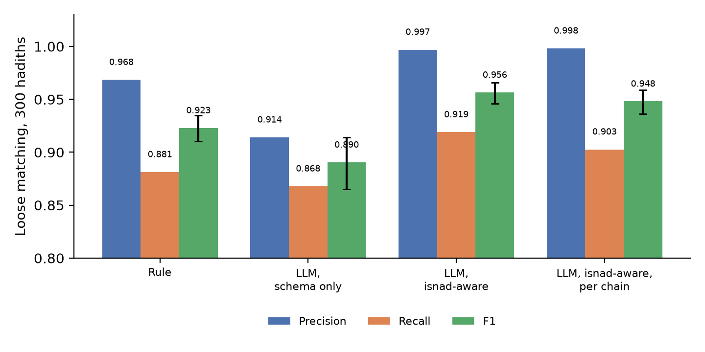

# Alıntı doğru, çıkarılan değer farklı: Hadis ravi zincirlerinde dil modeli ile bilgi grafı arasındaki kontrollerin ölçülmesi

::: {.authors}
Yahya Efe Kuruçay, Deniz Büyükşahin, Alperen Ulukaya

Bilgisayar Mühendisliği Bölümü, Akdeniz Üniversitesi, Antalya, Türkiye

Ön baskı taslağı, 13 Ekim 2026. Hakem değerlendirmesinden geçmemiştir.
:::

::: {.abstract}
**Özet.** Büyük dil modelleri (BDM) ile bilgi grafı kuran sistemler genellikle modelden bir kaynak alıntısı ve güven skoru ister; çıkarılan olguların hangilerine güvenileceğine bunlarla karar verir. Bu uygulamayı, Arapça hadis metinlerinin ravi zincirleri (isnad) üzerinde çalışan bir çıkarım motorunda sınadık. Motor, modeli öneri üreten bir bileşen olarak ele alır: her aday bir alıntı taşır, deterministik kontroller kuşkulu adayları insan incelemesine yönlendirir ve kabul edilen her olgunun kabulü kaydedilir. Altı temel hadis kitabından alınan 300 hadisi platform kaynaklı ravi etiketlerine karşı puanladık. Yalnız şema verilen modelin bütün alıntıları kaynakta bulunduğu için alıntı kontrolü hiçbir öneriyi işaretlemedi. Çıkarılan adın modelin kendi alıntısında geçip geçmediğini denetleyen kontrol ise önerilerin %9,2'sini işaretledi; bunlar, referansla eşleşmeyen 145 önerinin 122'sini içeriyordu. Bunların çoğu uydurulmuş raviler değildi: model adı çevriyazıya çevirmiş, ad hâlini değiştirmiş ya da akrabalık ifadesinin yerine bir ad yazmıştı. İncelemeye gönderilen önerilerin payı birbirine yakın tutulduğunda, kontrolün bulduğu 122 eşleşmeyen öneriye karşılık modelin güven skoru 50 öneri buldu. İsteme tip açıklamaları ve birkaç alan ipucu eklemek, eşleşmeyen öneri sayısını 145'ten 5'e indirdi ve kontrollerin bulabileceği pek az şey bıraktı. Hiçbir model çağrısı yapmayan kural tabanlı ayrıştırıcı, gevşek eşleştirmede diğer koşullarla yarışabilirken katı eşleştirmede belirgin biçimde daha kötü sonuç verdi. Motor, insanın kararlarını saklar ve geri kalan her şeyi yeniden türetir. Etiketli 27.056 zincir üzerindeki bir benzetimde, yalnız yazılı ada bağlanan kimlik kararı on geçişin birinde yanlış yeniden kullanıldı. Deterministik bir kural çelişki bulduğunda kararın kapsamını daraltmak, sabit dar anahtarın yaklaşık yarısı kadar inceleyici sorusuyla bu oranı 0,014'e indirdi. Referans etiketleri insanlarca oluşturulmuş bir altın standart değildir; koşulara hiçbir inceleyici katılmamış ve yalnız bir model kullanılabilir sonuç üretmiştir. Ölçümlerden hangi sonuçların çıkarılabileceğini ve çıkarılamayacağını belirttik.
:::

# 1 Giriş

Modellerle çıkarım, metni graf olgularına dönüştürmenin maliyetini düşürdü. Model, bir metin parçası ve şema alarak düğümler ve ilişkiler üretir. Güçlük, olgu üretmekten çok, insanların güveneceği bir grafa hangi olguların girebileceğine karar vermektir. Bunun için yaygın olarak iki önlem kullanılır. Modelden her olgu için kaynaktan alıntı yapması ve ne kadar emin olduğunu bildirmesi istenir. Alıntının olgunun nereden geldiğini göstermesi, güven skorunun ise insanın kontrol etmesi gereken olguları seçmesi beklenir.

Bu iki önlemi, yanlış bir olgunun sonuç doğurduğu ve etiketli verinin bulunduğu bir alanda inceledik. Hadis, rivayeti aktaran kişilerin zinciri olan isnadla başlar: "A bize anlattı, o B'den, o C'den". Araştırmacılar hadisi zincirindeki kişilere göre değerlendirir; dolayısıyla tek bir yanlış ad hükmü değiştirir. Büyük etiketli eğitim kümeleri bulunduğunda ince ayar yapılmış modeller ravileri ve aralarındaki bağları zaten başarıyla çıkarır [@oumer2025relation]. Altı temel hadis kitabının bilgi grafı oluşturulmuş [@kamran2023semantichadith; @kamran2026semantic] ve ravi adları biyografik veritabanlarına bağlanmıştır [@wirahman2026linking]. Bu çalışmaların sonuçlarını iyileştirmeyi amaçlamadık. Başka bir soruyu ele aldık: genel amaçlı bir model olgu önerdiğinde, model ile graf arasındaki hangi kontroller metinden sapan önerileri bulur ve bunların maliyeti nedir?

Kullandığımız motor iki tür olgu arasındaki ayrıma dayanır. Bir ayrıştırıcının ya da modelin metinden çıkardığı aday yeniden çıkarılabilir. Bu nedenle adayı türetilmiş sayar, ona doğrudan güvenmek yerine kontrol ederiz. İnsanın bir olguyu kabul etmesi, düzeltmesi ya da ravinin kimliğini belirlemesi metinden türetilemez ve bir kez saklanır. Makalenin büyük bölümünde ilk türün kontrolünü ele aldık. Bölüm 5.7'de ikinci türe ilişkin bir benzetim sunduk: kimlik kararını saklamanın ne sağladığını ve yeniden kullanımının maliyetini ölçtük.

Çalışmanın katkıları şunlardır.

- Modelin yalnız öneri üretebildiği, deterministik kontrollerin adayları bir gerekçe koduyla incelemeye yönlendirdiği ve kabul edilen her olgunun bir inceleyiciyi ya da otomatik politikayı belirten kabul kaydı taşıdığı bir motor geliştirdik (Bölüm 3).
- Daha önce görülmemiş 300 hadiste, bu motor içinde iki düşük maliyetli kontrolün neleri işaretlediğini ölçtük: alıntı-kaynakta ve değer-alıntıda. İlki hiçbir öneriyi işaretlemedi. İkincisi, referans etiketleriyle eşleşmeyen önerilerin %84'ünü işaretledi (Bölüm 5.2).
- İşaretlenen önerileri sınıflandırdık. Bu etiketlere göre, yalnız şema verilen modelin "hatalarının" çoğu uydurulmuş ravilerden değil, doğru bir ada uygulanan ve kaydedilmeyen dönüşümlerden oluşuyordu.
- Kontrolü, eşit inceleme bütçesinde modelin güven skoruyla karşılaştırdık (Bölüm 5.3). Aynı boru hattında çalıştırdığımız dört çıkarım koşulunu da eşli bootstrap aralıklarıyla karşılaştırdık (Bölüm 5.1).
- Etiketli zincirlerde yazılı bir adın ne sıklıkla birden çok raviyi temsil ettiğini nicel olarak gösteren bir taban çizgisi sunduk (Bölüm 5.6).
- İki etiketli derlem üzerinde kimlik karar defterinin benzetimini yaptık. Saklanan kararın kapsamını, deterministik bir kuralın saptadığı çelişkilerden türettik (Bölüm 5.7).

# 2 İlgili çalışmalar

**Hadis derlemleri ve çıkarım.** Sanadset 650K, düzenli ifadeler ve metin eşleştirmeyle üretilmiş ravi etiketleri taşıyan 650.986 kayıt sunar; veri makalesinde doğruluk ölçümü raporlanmaz [@mghari2022sanadset]. Ifta Sunnah veri ailesi, resmî bir hadis platformunun işaretlemelerini ravi metin aralıkları, aktarım ilişkileri ve ravi kimlikleri biçiminde yeniden düzenler. Yazarın model deposuna göre, bu verilerle eğitilen ince ayarlı modeller ravilerde 0,98, ilişki çiftlerinde 0,95 F1 değerine ulaşır [@oumer2025relation]. Önceki bir çalışma, uzun ve noktalamasız metinlerde isnad aralıklarını bulmuş ve eşleştirme kuralının sonucu ne kadar değiştirdiğini göstermiştir: aynı CRF çıktısı tam eşleştirmede 0,254, kısmi eşleştirmede 0,835 F1 almış; uzmanlar isnadın bittiği yerde vakaların %53'ünde tam olarak anlaşmıştır [@muther2020tracing]. İsnadı rivayet metninden n-gramlarla ayıran bir çalışma, 240 hadiste %92,5'e ulaşmıştır [@altammami2019text].

**Ravi kimliği.** AR-Sanad 280K, ravi kimliğini belirleme görevini 18.298 ravi üzerinde bir sınıflandırma problemi olarak tanımlar. En iyi modeli, 27.056 gerçek zincirde mikro F1 83,5'e ulaşırken zincirlerin %60,6'sı en az bir yanlış ravi içerir [@mahmoud2022arsanad]. Yakın tarihli bir boru hattı, 185.216 ad varyantını iki biyografik veritabanına bağlar; ancak etiketli bağlantılara karşı bir değerlendirme sunmaz [@wirahman2026linking].

**Hadis bilgi grafları ve modeller.** SemanticHadith, altı kitap için bir ontoloji ve graf yayımlar. Genişletilmiş sürümü, varlıkları özel bir NER modeliyle çıkarır ve uzmanların her kitaptan 100 örneği kontrol etmesine dayanır. Belirsiz adların uzmanlarca doğrulanacağı bir çerçeveyi gelecek çalışma olarak sıralar [@kamran2026semantic]. Hadis derlemlerinin modellerle işlenmesi, uzmanların 0 ile 10 arasındaki puanlarıyla [@asgari2025rezwan] ya da bir yazarın 100 kaydı kaynakla karşılaştırmasıyla değerlendirilmiştir [@cinici2026hadis]. Eleştirel bir derleme, ölçütlerin karşılaştırılabilirliğinin zayıf olmasını ve uzman doğrulamasının seyrekliğini alanın açık sorunları arasında sayar [@haque2026hadith].

**Çıkarılan olguların kontrolü.** Text2KGBench, referans üçlülere karşı precision ve recall yanında, üçlünün özne ve nesnesinin cümlede geçip geçmediğini ölçer. Bir model ve veri kümesinde 0,38 precision değerine karşılık 0,17 özne halüsinasyonu raporlar: metinde bulunmak, doğru olmak anlamına gelmez [@mihindukulasooriya2023text2kgbench]. Üretilen metnin kaynağa dayandırılmasını ve olgusal doğruluğunu ölçen ölçütler, cümle ya da atomik iddia düzeyinde çalışır [@rashkin2023measuring; @min2023factscore]. Modellerin bildirdiği güven skorları bir kalibrasyon problemi olarak incelenmiştir [@kadavath2022language; @xiong2024can]. Bilgi grafı çıkarımında, modelin alıntısıyla çıkardığı değer arasındaki ilişkiyi denetleyen bir kontrolün ayrı etkisini ölçen bir çalışma bulamadık. Taramamız sistematik değildi.

# 3 Sistem

GiraffeGraph Core, şemayı temel alan bir çıkarım motorudur. FastAPI arka ucu, üstveri için PostgreSQL, grafa işlenen veriler için Neo4j ve bir web paneli kullanır. Projede düğüm tipleri, ilişki tipleri, bunların özellikleri ve düğümün ya da ilişkinin kimliğini oluşturan özellikler tanımlanır. Kaynak metin bir kaynak birimi olarak alınır ve segmentlere ayrılır. Dil modeli ya da kural tabanlı program olabilen sağlayıcı, segmentler için aday düğümler ve ilişkiler önerir. Her aday, segment referansıyla birlikte bir ya da daha fazla alıntı taşır. Doğrulama aşamasında her adaya bir durum atanır: doğrulandı, inceleme gerekiyor ya da reddedildi. Bir koşu, ancak adaylarının hiçbiri inceleme beklemiyorsa grafa işlenebilir.

**Kontroller.** Burada üç kontrolü ele aldık. (i) *Şema*: tipi şemada bulunmayan aday tek başına çıkarılır; çağrının diğer adayları korunur ve tanımsız tip bir inceleme öğesi olarak kaydedilir. Tanımlanmamış özellik anahtarları da kaldırılır ve aynı şekilde kaydedilir. (ii) *Alıntı kaynakta mı*: adayın alıntısı, atıfta bulunduğu segmentin metninde geçmelidir. (iii) *Değer alıntıda mı*: ravi adı gibi, düğümün kimliğini oluşturan bir dizgi değeri adayın alıntılarından birinde geçmelidir. Karşılaştırmalarda Arapça harekeler ve harf varyantları dikkate alınmaz. (ii) ya da (iii) kontrolünden geçemeyen aday, güven skoru ne olursa olsun incelemeye yönlendirilir. Kontrolden geçememek olgunun yanlış olduğunu göstermediği için aday reddedilmez.

**Kabul kaydı.** İnceleme kararı, inceleyicinin adı, karar zamanı, harcanan süre ve bir düzeltme yapıldıysa önceki ve sonraki değerle birlikte saklanır. Kararlar eklenir; hiçbir zaman üzerlerine yazılmaz. Daha sonraki doğrulamalar, inceleyicinin karar verdiği bir adayı değiştirmez. Motor, grafa işlenen her olgu için ya insan kararını ya da onu kabul eden otomatik politikayı bildirir.

**İlişki kimliği.** Bir ilişki tipi kimlik özellikleri tanımlayabilir. Zincir ilişkisinde bunlar hadis referansı, zincir numarası ve konumdur. Böylece farklı hadislerde aynı iki ravi arasındaki iki aktarım iki ayrı kenar olur. Bu ayrım olmadan ikinci aktarım ilkinin üzerine yazılıyordu.

**Vaka çalışmasına özgü bileşenler.** Üç bileşen hadise özgüdür: 26 aktarım kalıbından oluşan bir sözlükle zincirin metin aralığını bulup zincir değiştirme işaretinde bölen kural tabanlı bir bölütleyici; kısa çıkarım ipuçları içeren bir şema şablonu (ravi, hadis, "rivayet etti", "aktarır"); bölütleyicinin çıktısını model çağrısı yapmadan adaylara dönüştüren bir sağlayıcı.

# 4 Deney düzeni

**Veri.** Test kümesi, altı temel hadis kitabının her birinden 50 olmak üzere 300 hadis içerir. Geliştirme sırasında kullanılan 50 hadisten biriyle metni eşleşen bütün kayıtları çıkardıktan sonra Ifta verilerinden sabit bir rastgelelik tohumu ile örneklem aldık [@internal-data-manifest]. Referans etiketleri platformda işaretlenmiş ravi geçişleridir. Toplam 1.778 geçiş vardır; hadis başına sayı 2 ile 11 arasındadır (medyan 6). Hadislerin 74'ü birden çok zincir içerir. Etiketler, bağımsız kodlayıcıların etiketlemesi değil, üçüncü bir tarafın yeniden düzenlediği platform işaretlemeleridir. Yer yer tutarsızlıklar vardır: derleyicinin yorumundaki raviler bazen işaretlenmiş, bazen işaretlenmemiştir. 300 hadisin 253'ü için Sanadset'te eşleşen bir kayıt vardır. Bu kayıtların düzenli ifadelerle üretilmiş etiketleri, gevşek eşleştirmede Ifta etiketleriyle 0,959 F1 düzeyinde uyuşur (%95 aralık 0,943 ile 0,972).

**Puanlama.** Analiz birimi hadistir. Sistem ve referans geçişlerini en büyük ağırlıklı iki parçalı eşleştirmeyle hizaladık. *Katı* eşleştirmede iki geçiş, normalize edilmiş dizgileri eşitse eşleşir. *Gevşek* eşleştirmede, birinin diğerini içermesi ya da belirteç F1 değerinin en az 0,60 olması da yeterlidir. Precision, recall ve F1 için mikro ortalama kullandık. Aralıklar, hadislerin 2.000 kez yeniden örneklenmesiyle elde edilen %95 yüzdelik bootstrap aralıklarıdır. Koşullar arasındaki farklarda eşli yeniden örnekleme kullandık. Gevşek eşleştirmede bir referans geçişiyle hizalanmayan öneriyi *eşleşmeyen* olarak adlandırdık. Eşleşmeme, doğrulukla değil, etiketlerin yüzey biçimiyle ilgili bir ifadedir.

**Koşullar.** Bütün koşulları aynı motorda, hiçbir inceleme kararı olmadan çalıştırdık.

| Koşul | Sağlayıcının girdisi | Sağlayıcı | İstem |
|---|---|---|---|
| Kural | Bölütleyiciden gelen zincir metin aralığı | Kural tabanlı, model yok | Yok |
| Şema-only | Hadisin tamamı, tek çağrı | Claude Haiku 5.5 | Tip adları ve çıktı sözleşmesi; açıklamalar çıkarıldı |
| İsnad bilgisi eklenen | Hadisin tamamı, tek çağrı | Claude Haiku 5.5 | Açıklamalar ve ipuçları: adları aynen kopyala, aktarım fiillerini dışarıda bırak, Peygamber ravi değildir |
| İsnad bilgisi eklenen, zincir metin aralığı | Bölütleyiciden gelen zincir metin aralığı | Claude Haiku 5.5 | İsnad bilgisi eklenen koşulla aynı |

Model, yapılandırılmış çıktı verir ve çaba parametresi `low` olarak ayarlanmıştır. Yanıtlar içerik adreslemeli bir önbellekte saklanır; böylece her koşu yeni çağrı yapmadan yeniden yürütülebilir. Koşularda motorun bellek içi depolamasını kullandık. Aynı boru hattı, PostgreSQL ve Neo4j üzerinde bütünleştirme testleriyle de sınanır.

# 5 Bulgular

## 5.1 Çıkarım

**Tablo 1.** 300 hadiste ravi geçişleri (1.778 referans geçişi). Gevşek eşleştirmede P, R ve F1; F1 için %95 aralık.

| Koşul | P | R | F1 | Katı F1 | Tam eşleşen zincirler |
|---|---|---|---|---|---|
| Kural | 0,968 | 0,881 | 0,923 [0,910, 0,935] | 0,633 | 0,490 |
| Şema-only | 0,914 | 0,868 | 0,890 [0,865, 0,914] | 0,826 | 0,567 |
| İsnad bilgisi eklenen | 0,997 | 0,919 | 0,956 [0,946, 0,966] | 0,904 | 0,690 |
| İsnad bilgisi eklenen, zincir metin aralığı | 0,998 | 0,903 | 0,948 [0,936, 0,959] | 0,897 | 0,650 |

Gevşek eşleştirmede yalnız şema verilen model, kural tabanlı ayrıştırıcının 0,032 F1 altında kaldı (aralık 0,006 ile 0,060). Katı eşleştirmede sıralama tersine döndü: değerler 0,633'e karşı 0,826 oldu. Ayrıştırıcı doğru adları buluyor, ancak metin aralıkları adın sonunu aşıyordu. Model ise sınırları düzgün adlar döndürüyor ve bazılarının biçimini değiştiriyordu. Yalnız şema içeren isteme açıklama ve ipuçları eklemek, F1 değerini 0,066 (0,041 ile 0,091), precision değerini 0,083 (0,059 ile 0,108) artırdı. Eşleşmeyen öneriler 145'ten 5'e düştü. Modelin girdisini zincir metin aralığıyla sınırlamak yarar sağlamadı (fark 0,008, aralık −0,002 ile 0,019). 300 hadisten yalnız 10'u birden çok çağrıya bölündüğünden bu koşul, uzun hadislerde zincir başına çağrı yapılmasını sınamıyor. Paralel zincirli hadislerde bütün koşulların recall değeri düştü. En büyük düşüş ayrıştırıcıdaydı (tek zincirli hadislerde 0,924, diğerlerinde 0,778).

## 5.2 Kontrollerin işaretledikleri

Şema-only koşulda kontrole ulaşan bütün alıntılar kendi segmentlerinde bulundu. Alıntı kontrolü hiçbir adayı işaretlemedi. Değer-alıntıda kontrolü, önerilen 1.688 geçişin 155'ini (%9,2) işaretledi.

**Tablo 2.** Şema-only koşul: referansla eşleşme ve değer-alıntıda kontrolüne göre öneriler.

| | Eşleşmeyen | Eşleşen |
|---|---|---|
| İşaretlenen | 122 | 33 |
| İşaretlenmeyen | 23 | 1.510 |

İşaretlenen önerilerin %79'u eşleşmeyen önerilerdi; bunlar toplam 145 eşleşmeyen önerinin %84'ünü oluşturuyordu. Tablo 3'te işaretlenen adları sabit kurallarla sınıflandırdık.

**Tablo 3.** Değişiklik türüne göre işaretlenen adlar (şema-only koşul).

| Değişiklik türü | Örnek: önce alıntı, sonra ad | İşaretlenen | Eşleşmeyen | Eşleşen |
|---|---|---|---|---|
| Latin harfleriyle çevriyazıya çevrilen | `حَدَّثَنَا الْأَعْمَشُ`, "al-A'mash" | 79 | 79 | 0 |
| Ad hâli değiştirilen | `عَنْ أَبِي بِشْرٍ`, `أَبُو بِشْرٍ` | 34 | 21 | 13 |
| Akrabalık ifadesi yerine ad yazılan | `عَنْ أَبِيهِ` ("babasından"), `عُرْوَةَ` | 25 | 18 | 7 |
| Diğer, ad metnin başka yerinde var | | 7 | 3 | 4 |
| Diğer, ad metinde yok | | 10 | 1 | 9 |

Bu sayıları üç noktayı dikkate alarak yorumlamak gerekir. İlk olarak, eşleşmeyen önerilerin çoğu doğru raviyi adlandırır. Bunların yetmiş dokuzu Latin harfli çevriyazılardır ve hepsi modelin alfabe değiştirdiği 14 hadisten gelir; 21'i ise ad hâli değişikliğidir. Gevşek eşleştirme kuralının belirteç eşiği yüzünden aynı hâl değişikliği iki sözcüklü bir adda eşleşmezken daha uzun bir adda eşleşir. Kontrol de puanlayıcı da yüzey biçimlerini karşılaştırdığı için aralarındaki uyumun bir bölümü tasarımdan kaynaklanır. İkinci olarak, akrabalık örnekleri metnin desteklediği çıkarımlardır: örnekte metin "Hisham ibn Urwa, babasından" der. 25 adın on beşi hadis metninde bulunur. Metinde hiçbir biçimiyle bulunmayan bir işaretlenmiş ad bulduk. Üçüncü olarak, kontrol kategori hatalarını kapsamaz. Eşleşmeyen on öneri Peygamber'i ravi olarak adlandırır; kontrol Latin harfleriyle yazılan ikisini işaretler, doğru kopyalanmış sekizini kaçırır.

Kontrolün gösterdiği şey, modelin alıntıladığından farklı bir şey yazıp bunu bildirmemesidir. Eşleşmeyen 145 önerinin 102'sinde hadis metninde bulunmayan bir ad vardır; kontrol bu 102 önerinin tamamını işaretler.

İşaretlenen aday, bir insan karar verene kadar kabul edilmediği için incelemesiz kabul edilen adayların precision değeri 0,914 yerine 0,985, recall değeri ise 0,868 yerine 0,849 olur. İnceleyici karar verene kadar grafa daha az veri girer: açık inceleme öğesi bulunan koşu grafa işlenmez. Bu durum 300 hadisin 110'unu bekletir; grafa işlenen çıktının precision değeri 0,983, recall değeri 0,582 olur.

İsnad bilgisi eklenen koşulda 1.639 önerinin 5'i eşleşmez. Kontrol bunların 3'ünü işaretler; eşleşen hiçbir öneriyi işaretlemez.

## 5.3 Güven skoru ile kontrolün karşılaştırılması

Şema-only koşulda, modelin güven skorunun önerinin eşleşmesini öngörmede ROC eğrisi altında kalan alanı 0,634'tür. Model yedi ayrı değer kullandı; 1.688 önerinin 1.623'ünün güven skoru 0,8 ile 1,0 arasındaydı.

**Tablo 4.** Güven skoru eşiği ve kontrol aracılığıyla incelemeye gönderilen eşleşmeyen öneriler (toplam 145 eşleşmeyen öneri).

| Sinyal | İncelemeye gönderilen öneriler | İçlerindeki eşleşmeyenler |
|---|---|---|
| Güven skoru 0,80'in altında | 65 (%3,9) | 16 |
| Güven skoru 0,85'in altında | 275 (%16,3) | 50 |
| Güven skoru 0,90'ın altında | 1.018 (%60,3) | 110 |
| Değer-alıntıda kontrolü | 155 (%9,2) | 122 |

## 5.4 İnceleme yükü ve maliyet

Şema-only koşul, 538 adayı (155 düğüm ve 383 ilişki) incelemeye gönderir ve 300 hadisin 190'ını incelemesiz grafa işler. İsnad bilgisi eklenen koşulda bu sayılar 16 ve 294'tür. Sağlayıcının 6 Ekim 2026 tarihli liste fiyatlarıyla, 1.000 hadis başına çıkarım maliyeti şema-only koşulda 1,87 USD, isnad bilgisi eklenen koşulda 2,29 USD'dir. Çağrı başına medyan gecikme 11 ile 13 saniye arasındadır. Bu makaledeki bütün koşuların maliyeti 3,49 USD oldu. İnsan incelemesinin süresini ölçmedik.

## 5.5 İkinci modelle başarısız bir koşu

Aynı aileden daha büyük bir model olan Claude Sonnet 5.5'i aynı ayarlarla hadislerin 36'sında çalıştırdık. İsnad bilgisi eklenen koşulda bunların 28'i için tek ravi döndürdü ve genellikle ravi adını özellik anahtarı alanına yazdı. Gevşek recall değeri, aynı hadislerde Haiku 5.5'in 0,916 değerine karşılık 0,237 oldu. Yapılandırmamızda iki olası nedenden kuşkulanıyoruz: hem liste öğesinin hem özelliğin `name` olarak adlandırıldığı belirsiz bir veri aktarım biçimi ve modeller arasında aynı şekilde kalibre edilmemiş bir akıl yürütme ayarı. İkisini de sınamadık. Bu koşu bir model karşılaştırması değildir. Ancak motorun hata durumunda güvenli davrandığını gösterir: 29 tanımsız özellik anahtarı inceleme için kaydedildi, kimlik değeri bulunmayan düğümler reddedildi, 36 koşunun 30'unun grafa işlenmesi engellendi ve önerilerin precision değeri 0,966 ya da üzerinde kaldı.

## 5.6 Yazılı ad kimlik değildir

Motor, ravi düğümünü yazılı adıyla tanımlar. Ifta etiketleri her zincir konumuna bir kişi kimliği bağlar. Böylece bu tercihin sonucunu bir sistem çalıştırmadan ölçebildik. 300 hadisteki 2.150 zincir konumunda 740 kişi yer alır. Konumları adın yazıldığı biçime göre gruplamak 964 grup verir. Bunların 24'ü birden çok kişiyi kapsar ve konumların %10,0'ını içerir; kişilerin %25,8'i ise birden çok gruba bölünür (ikili precision 0,737, recall 0,559; B-cubed 0,941 ve 0,715). Adı normalize etmek bölünmeyi azaltır (%21,8), farklı kişilerin birleştirilmesini artırır (konumların %12,2'si). En belirsiz ad, 34 kişiyi temsil eden "babası" akrabalık ifadesidir.

## 5.7 Kimlik kararının saklanması

Ad kimlik değilse, kimin kastedildiğine bir insan karar vermelidir ve bu kararı saklamak yararlıdır. Etiketli zincirleri her seferinde bir geçiş okuyarak işleyen, daha önce görmediği bir anahtarla karşılaştığında inceleyiciye soran ve daha sonra cevabı yeniden kullanan bir defterin benzetimini yaptık. İnceleyicinin cevabı veri kümesinin etiketidir. İnceleyiciye yöneltilen her öğeyi soru, yeniden kullanılan ve etiketle uyuşmayan cevabı sessiz hata saydık. Veriler, AR-Sanad 280K'nin 27.056 test zincirinden (150.904 geçiş, 6.378 kişi) [@mahmoud2022arsanad] ve başka bir kaynağın etiketleriyle tekrar için, altı Ifta kitabının ravi kimliği taşıyan 34.681 hadisinden (205.514 geçiş) oluşur. Değerler, beş rastgele sıralamanın ortalamalarıdır.

Belirleyici olan, saklanan kararın kapsamıdır: cevabın yeniden kullanılabilmesi için sonraki bir geçişin öncekiyle ne kadar ortak bağlam taşıması gerekir? Kapsamı daraltan politikada her ad için başlangıçta yalnız ad kullanılır. Ancak o ad için bir çelişki görüldükten sonra anahtara addan önce gelen ravi eklenir. Çelişkiyi saptayan mekanizma ravi kataloğu üzerinde çalışan bir kuraldır. Önerilen kişi ile komşu ravi arasında çok fazla tabaka ya da vefat yılı farkı varsa inceleyiciye sorar. Sınırlarını AR-Sanad üzerinde seçtik ve Ifta verilerine değiştirmeden uyguladık.

**Tablo 5.** Geçiş başına soru ve sessiz hata.

| Politika | AR-Sanad: sorular | AR-Sanad: sessiz hatalar | Ifta: sorular | Ifta: sessiz hatalar |
|---|---|---|---|---|
| Sabit kapsam: ad | 0,101 | 0,100 | 0,077 | 0,102 |
| Sabit kapsam: ad; kural yalnız işaretlenen geçişi sorar | 0,204 | 0,054 | 0,229 | 0,049 |
| Kuralın daralttığı kapsam | 0,178 | 0,014 | 0,199 | 0,010 |
| Sabit kapsam: önceki ravi ve ad | 0,340 | 0,006 | 0,292 | 0,007 |

Yalnız ada bağlanan karar, on geçişin birinde yanlış yeniden kullanılır. Kuralın çelişki gördüğü yerlerde kapsamı daraltmak, dar anahtarın yaklaşık yarısı ile üçte ikisi kadar soruyla onun hata düzeyine yaklaşır. Aynı kural yalnız işaretlenen geçişi inceleyiciye göndermek için kullanıldığında hata 0,05 dolayında kalır. Yararı sağlayan, tek bir çelişkinin o adın daha sonraki bütün geçişlerinin nasıl ele alınacağını değiştirmesidir. Defteri beş Ifta kitabıyla doldurup altıncı kitapta ölçtüğümüzde, kapsamı daraltan politika geçiş başına 0,004 ile 0,016 arasında sessiz hata verdi ve altı kitabın her birinde dar anahtardan daha az soru sordu.

Metinden ikinci kez çıkarım yapıldıktan sonra saklanan kararın yeniden bulunabilmesi de gerekir. Hedef olarak hadis ve normalize ad çiftini kullandığımızda, bir model koşusundaki ravi adaylarının 0,857 ile 0,977 arasındaki bölümü farklı bir istemle yapılan koşuda karşılık buldu. Kural tabanlı ayrıştırıcı ile bir model koşusu arasında bu oran 0,561 ile 0,634 arasındaydı.

# 6 Tartışma

**Modelin metinden saptığı yer alıntı değildir.** Gerçek metni göstermek, alıntı gereksinimini karşılar. Koşularımızda model bunu her seferinde yaptı ve ardından alıntılanan metinde bulunmayan bir değer yazdı. Dolayısıyla yalnız alıntıya uygulanan kontrol, değer hakkında bir şey söylemez. Değeri alıntıyla karşılaştırmak bir ek dizgi karşılaştırması gerektirir ve eşleşen önerileri eşleşmeyenlerden ayıran tek sinyal bu oldu.

**İşaretlenmek yanlış olmak anlamına gelmez.** İşaretlenen her beş addan biri referansla eşleşiyordu; eşleşmeyenlerin çoğu da doğru kişinin başka biçimde yazılmış adıydı. Bu tür bir kontrol, adayı reddetmek yerine bir insana ya da açık bir kurala yönlendirmelidir. Ad hâli değişikliklerini kabul edip bunu kaydeden bir kural, işaretlenen 33 eşleşen adın 13'ünü inceleme gereğinden kurtarabilir.

**Talimatlar kontrollerden daha etkiliydi; kontroller ise talimatlar başarısız olduğunda gerekliydi.** Birkaç kısa ipucu ve tip açıklamaları, eşleşmeyen önerilerin neredeyse tamamını ortadan kaldırdı. Bu sayı, herhangi bir kontrolün bulduğundan fazlaydı. Başarısız koşunun gösterdiği gibi, kontroller istemin, modelin ya da yapılandırmanın yanlış olduğu durumlarda iş görür.

**Katı kabul politikası işi inceleyiciye aktarır.** Bir aday inceleme beklerken hadisin tamamını grafın dışında tutmak grafı korur ve eksik bırakır: şema-only koşulda, herhangi bir inceleme öncesindeki recall değeri 0,582'dir. Tasarımın başarısı, ölçmediğimiz inceleme adımının başarısına bağlıdır.

**Saklanan şey karardır.** Çıkarımın adayları değiştirilebilir; aynı metin başka bir istemle ya da modelle yeniden okunabilir. Ravinin kimliği ve bir olgunun kabulü metinde bulunmaz. Benzetim, bu kararların sık yeniden kullanıldığını, yalnız ada göre yeniden kullanımın güvenli olmadığını ve düşük maliyetli bir kural çelişki bulana kadar kararın kapsamının geniş tutulabileceğini düşündürüyor. Motor bunu henüz yapmıyor: kararı bir adaya bağlıyor ve tarih kuralı içermiyor.

# 7 Sınırlılıklar

Referans, bağımsız kodlayıcıların oluşturduğu altın standart değil, platform işaretlemesidir; mutlak puanlar doğruluk olarak okunmamalıdır. Değer-alıntıda kontrolünün eşleşmeyen önerilerin ne kadarını işaretlediği, bu göreve ve isteme özgüdür. İnsan etiketli BC5CDR derleminin 300 özetinde [@li2016bc5cdr], aynı model ve yalnız şema içeren bir istemle, kontrol 2.269 önerinin %3,9'unu işaretledi. Bunlar, etiketlerle eşleşmeyen 303 önerinin 53'ünü içeriyordu; modelin güven skoru ise aynı inceleme payında 58'ini buldu. Buradaki eşleşmeyen önerilerin çoğu, kodlayıcıların etiketlemediği metin aralıklarının aynen kopyalarıydı. Hiçbir inceleyici katılmadığından döngünün insan kısmı uygulanmış ve test edilmiş, ancak değerlendirilmemiştir. Karar defteri benzetiminde inceleyici veri kümesinin etiketidir: ilk cevap ücretsiz ve her zaman doğrudur, soru ne kadar zaman alacak olursa olsun bir birim sayılır ve altı kitabın ravilerinin çoğu ortaktır. Kullanılabilir bütün sonuçlar tek modelden, tek ayardan ve koşul başına tek koşudan gelir. Eşleşmeyen öneri mutlaka yanlış bir ifade değildir. İlişkileri değil, ravi geçişlerini puanladık. Hadisler iyi bilinmektedir ve muhtemelen modelin eğitim verisinde vardır; adları değiştirerek ezberlemeyi sınamadık. Tip ve özellik kontrollerini geliştirmemize yol açan şema sapması, çalışan modelde neredeyse hiç görülmediği için normal kullanım sıklığını belirleyemedik. Kural tabanlı bölütleyiciyi, test kümesinin dışında tutulan 50 hadiste ayarladık.

# 8 Sonuç

Çalışan bir çıkarım motorunda, daha önce görülmemiş 300 hadis üzerinde, çıkarılan değerin modelin kendi alıntısında geçip geçmediğini denetleyen kontrol, yetersiz talimat verilmiş modelin referansla eşleşmeyen önerilerinin çoğunu işaretledi. Alıntının kaynakta geçip geçmediğini denetleyen kontrol hiçbirini işaretlemedi; modelin güven skoru ise aynı inceleme bütçesinde çok daha azını buldu. Kontrolün buldukları çoğunlukla doğru adların kaydedilmemiş dönüşümleridir. Daha iyi talimatlar bu modelde sorunu neredeyse ortadan kaldırdı. Benzetimde, kapsamı çelişki görüldüğünde daralan bir kimlik kararı, daha az soruyla dar anahtarın hata düzeyine yaklaştı. Sonraki adımlar, insan etiketli bir referans oluşturmak, inceleme süresini ölçerek bir inceleyiciyi döngüye katmak, defteri bu inceleyicinin kararlarıyla yeniden sınamak, daha fazla model kullanmak, ilişki düzeyinde puanlama yapmak ve ravi adlarını bir otorite listesine bağlamaktır.

# Yapay zekâ araçlarının kullanımına ilişkin beyan

Yapay zekâ asistanları, yazarların yönlendirmesiyle değerlendirilen sistemin kodunun büyük kısmını, analiz betiklerini ve bu metnin ilk taslağını yazdı. Kaynakça kayıtları dizinlerden ya da yayıncı sayfalarından alındı. Ölçülen her sayı, saklanan model yanıtlarından bir betikle üretilir. Bir taslak, bağımsız bir yapay zekâ inceleyicisi tarafından sonuç dosyalarıyla karşılaştırıldı; dosyaların desteklemediği yerlerde iddialar daraltıldı. İçeriğin sorumluluğu yazarlara aittir.

# Veri ve kod

Kod, değerlendirme betikleri, önbelleğe alınmış model yanıtları ve sonuç dosyaları proje deposundadır. Depo geliştirme süresince özeldir; proje sonunda motoru açık kaynak lisansıyla yayımlamayı planlıyoruz. Hadis verileri üçüncü taraf kaynaklardan gelir ve yalnız değerlendirme için kullanılır. Veri envanteri, her kaynağı, kaynağın kendi lisans beyanıyla birlikte listeler [@internal-data-manifest].
